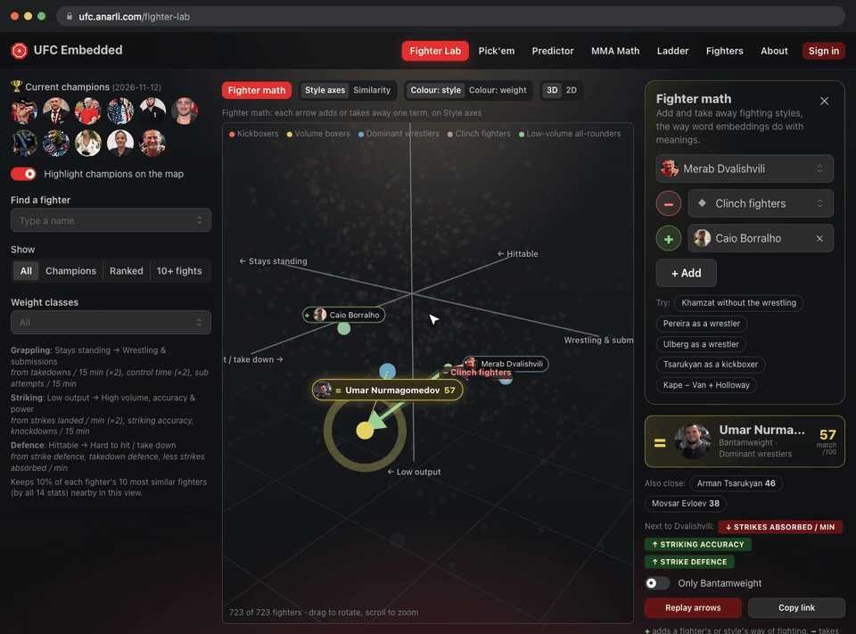

<h2 align="center">Anar Abbasli</h2>

  Mathematics · Machine learning · Generative modeling 
  M.Sc. Mathematics in Data Science, TUM · B.Sc. Computer Science, KAIST

  
  
  

---

**Master's thesis:** discrete diffusion language models, at [DAML, TUM](https://www.cs.cit.tum.de/daml/).

**Currently building [UFC Embedded](https://ufc.anarli.com).** Machine learning for mixed martial arts. Every fighter becomes a vector learned from their fight stats, so fighting styles can be added and taken away like word embeddings: take a striker, remove the striking, add wrestling, and see which real fighter comes out. It also predicts upcoming fights and runs a free prediction game with leagues.

  

